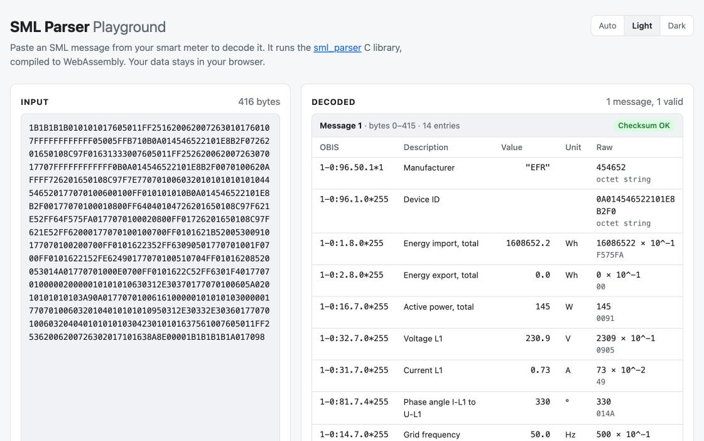

[](https://registry.platformio.org/libraries/olliiiver/SML%20Parser) [](https://github.com/olliiiver/sml_parser/actions)

# Smart Message Language (SML) parser

Easy to use C library with a low memory footprint to parse SML messages (based on BSI TR-03109-1) byte by byte from smart meters. It's designed to be lightweight and efficient and has a small memory footprint, making it suitable for use on embedded systems or other devices with limited memory resources.

The library will control the last CRC value to check if the received data is correct. On any error, the parser will reset and wait for valid data. This allows to start parsing at any time. For example, a half received message is discarded. The library allows you to register handlers to process the received information. This feature allows you to easily process the data in your application without having to handle the low-level details of parsing the SML messages.

It's actively maintained and has already been used in various projects with meters from EMH, EFR, EasyMeter, etc.

The API is described in [`sml.h`](src/sml.h) via doxygen comments.

## Playground

> [!TIP]
> **[Try it in your browser](https://olliiiver.github.io/sml_parser/)**: paste an SML message from your meter and see what the parser makes of it. The playground runs this library compiled to WebAssembly, so your data never leaves your browser (see [web](web/)).

[](https://olliiiver.github.io/sml_parser/)

## Examples

| Directory                                              | Description                                                    |
| ------------------------------------------------------ | -------------------------------------------------------------- |
| [arduino](examples/arduino/)                           | Loops through static data and outputs debug messages to serial |
| [arduino_serial](examples/arduino_serial/)             | Reads data from Arduino Pin 8 and outputs debug to serial      |
| [esp32_lora](examples/esp32_lora/)                     | Forward energy usage to LoraWAN (The Things Network)           |
| [esp32_m5stack_sender](examples/esp32_m5stack_sender/) | Use m5stack to produce a message for testing                   |
| [esp32_receiver](examples/esp32_receiver/)             | Receive messages and show infos on a display                   |
| [native](examples/native/)                             | Test library locally                                           |
| [native_entries](examples/native_entries/)             | Print all values and watch OBIS codes configured as strings    |

The easiest way to test the library would be over the [native](examples/native/) example.

## Example usage

```cpp
void Manufacturer() {
  smlOBISManufacturer(manuf, MAX_STR_MANUF);
}

void PowerT1() {
  smlOBISWh(T1Wh);
}

void PowerSum() {
  smlOBISWh(SumWh);
}

SMLHandler SMLHandlers[] = {
  {{ 0x81, 0x81, 0xc7, 0x82, 0x03, 0xff }, &Manufacturer}, /* 129-129:199.130.3*255 */
  {{ 0x01, 0x00, 0x01, 0x08, 0x01, 0xff }, &PowerT1},      /*   1-  0:  1.  8.1*255 (T1) */
  {{ 0x01, 0x00, 0x01, 0x08, 0x00, 0xff }, &PowerSum},     /*   1-  0:  1.  8.0*255 (T1 + T2) */
  {{ 0, 0 }}
};

int main () {
  int i = 0, iHandler = 0;
  unsigned char c;
  sml_states_t s;
  for (i = 0; i < ehz_bin_len; ++i) {
    c = ehz_bin[i];
    s = smlState(c);
    if (s == SML_START) {
      /* reset local vars */
      manuf[0] = 0; T1Wh = -3; SumWh = -3;
    }
    if (s == SML_LISTEND) {
      /* check handlers on last received list */
      for (iHandler=0; SMLHandlers[iHandler].Handler != 0 &&
            !(smlOBISCheck(SMLHandlers[iHandler].OBIS)); iHandler++);
      if (SMLHandlers[iHandler].Handler != 0) {
        SMLHandlers[iHandler].Handler();
      }
    }
    if (s == SML_UNEXPECTED) {
      printf(">>> Unexpected byte! <<<\n");
    }
    if (s == SML_FINAL) {
      printf(">>> FINAL! Checksum OK\n");
      printf(">>> Manufacturer.............: %s\n", manuf);
      printf(">>> Power T1    (1-0:1.8.1)..: %.3f kWh\n", T1Wh);
      printf(">>> Power T1+T2 (1-0:1.8.0)..: %.3f kWh\n\n", SumWh);
    }
  }
}
```

## Reading all values

If the OBIS codes of a meter are not known in advance (e.g. to show the user
which values a meter sends, or to configure handlers at runtime), use
`smlOBISEntry` after each `SML_LISTEND`. It returns OBIS code, unit, scaler and
value of every entry. `smlOBISToString` and `smlOBISFromString` convert OBIS
codes from and to the `A-B:C.D.E*F` notation.

```cpp
sml_obis_entry_t entry;
char obis[24];

if (s == SML_LISTEND && smlOBISEntry(entry)) {
  smlOBISToString(entry.obis, obis, sizeof(obis));
  if (entry.type == SML_DATA_SIGNED_INT || entry.type == SML_DATA_UNSIGNED_INT) {
    printf("%s: %.3f (unit %d)\n", obis, entry.value * pow(10, entry.scaler), entry.unit);
  }
}
```

See the [native_entries](examples/native_entries/) example.

## Memory usage

The parser processes the data byte by byte and never stores a whole message. Each `SmlParser` instance needs 101 bytes of RAM on an ATmega (e.g. Arduino Uno), all static, without heap usage:

| Member                                   | Bytes   | Purpose                                                                                       |
| ---------------------------------------- | ------- | --------------------------------------------------------------------------------------------- |
| `listBuffer[80]`                         | 80      | Holds the current list entry (OBIS code, unit, scaler, value, ...) until `SML_LISTEND`         |
| `nodes[10]`                              | 10      | Nesting stack, remaining elements per list level (up to 10 levels)                            |
| `currentState`                           | 1       | Current state of the state machine                                                            |
| `crc`, `crcMine`, `crcReceived`          | 6       | Running CRC-16, calculated and received checksum                                              |
| `currentLevel`, `len`, `listPos`, `sc`   | 4       | Current nesting level, remaining bytes of the field, buffer position, scaler of the last value |
| **Total**                                | **101** |                                                                                               |

On 32 bit platforms like the ESP32 an instance needs 102 bytes because of alignment. The global instance `SmlParser1` used by the C style functions counts once, every additional instance (e.g. for a second meter) needs the same again. With `SML_DEBUG` enabled, a 200 byte log buffer is added per instance. An `sml_obis_entry_t` returned by `smlOBISEntry` takes 20 bytes on an ATmega and 32 bytes on an ESP32.

Flash usage on an ATmega328P (Arduino Uno, avr-gcc 7.3, `-Os`), measured as the difference to an empty sketch:

| Functions used                                   | Flash        |
| ------------------------------------------------ | ------------ |
| `smlState` (parsing only)                        | 1.1 KB       |
| `smlOBISCheck` and `smlOBISByUnit` (integer)     | + 0.6 KB     |
| `smlOBISCheck` and `smlOBISWh` (floating point)  | + 1.4 KB     |
| `smlOBISEntry`                                   | + 0.6 KB     |

The floating point routines behind `smlOBISWh` and the other unit functions are shared if your program already uses `double`. Use `smlOBISByUnit` or `smlOBISEntry` to avoid them. Parsing a byte with `smlState` needs less than 32 bytes of stack.

## Debug mode

If debug mode via `SML_DEBUG` (see examples/native/platformio.ini) is enabled, the SML data is displayed in a tree like structure.

```
START
 LISTSTART on level 1 with 6 nodes
  Data 6 (length = 6, octet string): 00 0C 04 08 87 2D
  Data 5 (length = 1, unsigned int): 00
  Data 4 (length = 1, unsigned int): 00
  LISTSTART on level 2 with 2 nodes
   Data 2 (length = 2, unsigned int): 01 01
   LISTSTART on level 3 with 6 nodes
    Data 6 (empty)
    Data 5 (empty)
    Data 4 (length = 6, octet string): 00 0C 06 9E 2D 0F
    Data 3 (length = 10, octet string): 06 45 4D 48 01 00 1D 46 15 CA
    Data 2 (empty)
    Data 1 (empty)
   LISTEND
   back to previous list
  back to previous list
  Data 2 (length = 2, unsigned int): 2B 8E
 End of block at level 1
 back to previous list
 LISTSTART on level 1 with 6 nodes
  Data 6 (length = 6, octet string): 00 0C 04 08 87 2E
  Data 5 (length = 1, unsigned int): 00
  Data 4 (length = 1, unsigned int): 00
  LISTSTART on level 2 with 2 nodes
   Data 2 (length = 2, unsigned int): 07 01
   LISTSTART on level 3 with 7 nodes
    Data 7 (empty)
    Data 6 (length = 10, octet string): 06 45 4D 48 01 00 1D 46 15 CA
    Data 5 (empty)
    LISTSTART on level 4 with 2 nodes
     Data 2 (length = 1, unsigned int): 01
     Data 1 (length = 4, unsigned int): 06 9E FA 83
    LISTEND on level 4
    back to previous list
    LISTSTART on level 4 with 7 nodes
     LISTSTART on level 5 with 7 nodes
      Data 7 (length = 6, octet string): 81 81 C7 82 03 FF
      Data 6 (empty)
      Data 5 (empty)
      Data 4 (empty)
      Data 3 (empty)
      Data 2 (length = 3, octet string): 45 4D 48
      Data 1 (empty)
     LISTEND
     back to previous list
     LISTSTART on level 5 with 7 nodes
      Data 7 (length = 6, octet string): 01 00 00 00 09 FF
      Data 6 (empty)
      Data 5 (empty)
      Data 4 (empty)
      Data 3 (empty)
      Data 2 (length = 10, octet string): 06 45 4D 48 01 00 1D 46 15 CA
      Data 1 (empty)
     LISTEND
     back to previous list
     LISTSTART on level 5 with 7 nodes
      Data 7 (length = 6, octet string): 01 00 01 08 00 FF
      Data 6 (length = 2, unsigned int): 01 82
      Data 5 (empty)
      Data 4 (length = 1, unsigned int): 1E
      Data 3 (length = 1, signed int): 03
      Data 2 (length = 5, signed int): 00 00 00 1C 46
      Data 1 (empty)
     LISTEND
     back to previous list
     LISTSTART on level 5 with 7 nodes
      Data 7 (length = 6, octet string): 01 00 01 08 01 FF
      Data 6 (empty)
      Data 5 (empty)
      Data 4 (length = 1, unsigned int): 1E
      Data 3 (length = 1, signed int): FF
      Data 2 (length = 8, signed int): 00 00 00 00 07 5B CD 15
      Data 1 (empty)
     LISTEND
     back to previous list
     LISTSTART on level 5 with 7 nodes
      Data 7 (length = 6, octet string): 01 00 01 08 02 FF
      Data 6 (empty)
      Data 5 (empty)
      Data 4 (length = 1, unsigned int): 1E
      Data 3 (length = 1, signed int): 03
      Data 2 (length = 5, signed int): 00 00 00 1C 46
      Data 1 (empty)
     LISTEND
     back to previous list
     LISTSTART on level 5 with 7 nodes
      Data 7 (length = 6, octet string): 01 00 0F 07 00 FF
      Data 6 (empty)
      Data 5 (empty)
      Data 4 (length = 1, unsigned int): 1B
      Data 3 (length = 1, signed int): FF
      Data 2 (length = 4, signed int): 00 00 2F 65
      Data 1 (empty)
     LISTEND
     back to previous list
     LISTSTART on level 5 with 7 nodes
      Data 7 (length = 6, octet string): 81 81 C7 82 05 FF
      Data 6 (empty)
      Data 5 (empty)
      Data 4 (empty)
      Data 3 (empty)
      Data (length = 48): FF FF FF FF FF FF FF FF FF FF FF FF FF FF FF FF FF FF FF FF FF FF FF FF FF FF FF FF FF FF FF FF FF FF FF FF FF FF FF FF FF FF FF FF FF FF FF FF
      Data 2 (empty)
      Data 1 (empty)
     LISTEND
     back to previous list
    back to previous list
    Data 2 (empty)
    Data 1 (length = 2, unsigned int): B9 3F
   LISTEND on level 3
   back to previous list
  back to previous list
 End of block at level 1
  LISTSTART on level 2 with 6 nodes
   Data 6 (length = 6, octet string): 00 0C 04 08 87 31
   Data 5 (length = 1, unsigned int): 00
   Data 4 (length = 1, unsigned int): 00
   LISTSTART on level 3 with 2 nodes
    Data 2 (length = 2, unsigned int): 02 01
    LISTSTART on level 4 with 1 nodes
     Data 1 (empty)
    LISTEND
    back to previous list
   back to previous list
   Data 2 (length = 2, unsigned int): 6A 53
  End of block at level 2
  back to previous list
 back to previous list
End of block at level 0
Received checksum: C6E8
Calculated checksum: C6E8
>>> FINAL! Checksum OK
>>> Manufacturer.............: EMH
>>> Power T1    (1-0:1.8.1)..: 12345678.900 Wh
>>> Power T1+T2 (1-0:1.8.0)..: 7238000.000 Wh
```

## Used by

- [Energy2Shelly_ESP](https://github.com/TheRealMoeder/Energy2Shelly_ESP)

## Links

The following sites provided a lot of helpful information to me.

- https://wiki.volkszaehler.org/software/obis
- https://wiki.volkszaehler.org/software/sml
- https://www.stefan-weigert.de/php_loader/sml.php
- https://github.com/devZer0/libsml-testing

## License

GNU LGPL v2.1
